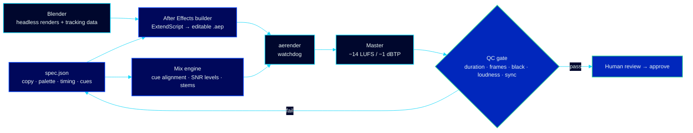

# Digital Motion Lab — Motion Design, VFX & Sound

> A production studio run as software. Every video starts as a JSON spec, is built into an editable After Effects project by script, gets its sound mixed by a measuring engine, and is passed or failed by an automated QC gate before a human ever sees it.
> **Role:** creative director, technical director and pipeline engineer · **Client work for:** [Opportunity Education Tanzania](https://www.opportunityeducation.org/)

The studio codebase is private. This page shows the work and explains how it is made.

## Featured film — *Partnership*

A 70-second vertical film that asks owners of school networks, NGOs and government to bring their schools into Opportunity Education's learner-centred model.

It opens on a moment everyone remembers from school. A teacher asks Memphis to state Archimedes' principle. She recites it by heart, stalls on *"…upthrust…"*, and the word comes back once more, quieter, until the room goes silent. Nobody says "rote learning". The sound says it.

Then the same classroom, from the same camera, turns learner-centred on a single frame. Music drop, taiko hit and light wipe land together at 20.45 s.

  <video src="https://github.com/user-attachments/assets/229762b9-d485-41e5-aeb3-b5e59d2009b9" width="360" controls playsinline></video>

Press play and tap the speaker icon for sound: the full 70-second film in Full HD (1080 × 1920) with its original sound. Also available as a <a href="media/Partnership_v010B.mp4">file in this repo</a>.

| | |
|---|---|
| Format | 1080 × 1920, 30 fps, 70.0 s, 2100 frames |
| Delivery | −14.0 LUFS, −0.8 dBTP, 0 black frames (automated QC: PASS) |
| Voices | 3 hook lines + 13 narration lines, every on-screen event timed to word timestamps |
| Sound | 34 timed effects, all real recordings, plus one music edit cut so its drop hits the turn |
| Status | Approved, 10 October 2026 |

### Every event on the clock

The chart is drawn straight from the film's production spec, so it is the real timing, not an illustration of it.

### Craft decisions that carried it

- **The fade is the message.** Memphis's last word returns 13 dB quieter, low-passed at 3.5 kHz and drowned in a 1.1 s reverb, while the picture drains to 65 % grey. Level, filter, space and colour fail together, so the audience feels the memory go.
- **Silence before the turn.** The music drops to −40 dB for 0.4 s right before the downbeat. That gap is what makes the turn hit.
- **No AI video in the opening.** Generated clips read as fake, so the scene is built in After Effects from four rear-view stills: push-ins, a handheld wiggle, grain, a creeping vignette. With no visible mouths, no lip-sync is needed.
- **The timeline follows the voice.** Segment lengths and word timestamps drive the edit. Map rings fire on *families*, *communities* and *nation*; product chips land on *coaches*, *Quest* and *Career*. Re-record a line and the whole film re-flows.
- **A 3D map that the graphics stick to.** Tanzania is a Blender camera move. Its per-frame screen positions become After Effects tracker nulls, so rings, labels and ten school dots stay locked to the moving map.
- **Sound in key.** Skill hits are timpani tuned to the track's tonic. The schools light up on a rising kalimba run in the same key. There are no arcade beeps anywhere.
- **Spoken in full.** On screen it reads *TIE-approved*; the narrator says *approved by the Tanzania Institute of Education*.

## How the studio works

- **Specs, not timelines.** Copy, colours, fonts, timings and every sound cue live in one JSON file. Brand is data, so a new client swaps in without touching the builder.
- **Editable output.** The builder writes a named, layered After Effects project with control layers and expressions. A motion designer can open it and keep working by hand.
- **A mixer that measures.** Each effect is aligned by its onset or its peak and set by its ratio to the music at that moment, so a whoosh never vanishes under a loud bar. Stems are exported so After Effects reproduces the mix exactly.
- **Evidence over claims.** A version only counts once it is rendered, probed and inspected frame by frame. QC checks duration, frame count, black frames, loudness, true peak and effect sync against the spec.
- **Research before design.** Reference films are measured (cut rhythm, type size, loudness) instead of guessed, and every project ships research records that the next project reuses.
- **Built on a laptop.** The whole pipeline runs on a 2-core Intel i5 with integrated graphics, which forced the scripts to be efficient: small previews, headless renders, cached passes.

## Toolchain

| Layer | Tools |
|---|---|
| Motion | Adobe After Effects 2026 (ExtendScript builds, aerender), Media Encoder |
| 3D / VFX | Blender 5.2 (headless Python, camera moves, tracking export) |
| Sound | Python (NumPy, SciPy) mix engine, FFmpeg loudness mastering, licensed and CC recordings |
| Voice | HeyGen voices, word-level timestamps |
| Imagery | Google Flow (Nano Banana) stills, Photoshop |
| QC | Python + OpenCV frame checks, ffprobe, EBU R128 loudness |

## Credits

Produced for **Opportunity Education Tanzania**. Music: *African night* by ECO-ART (Pixabay Content License).

Sound effects under CC BY 4.0, all from Freesound:
- "Movie Trailer Boom" and "Deepest Boom Yet" by hykenfreak;
- "Bar_Chimes_Sweep_Up.wav" by pjcohen;
- "COPLAND DRUM 01.wav" by sandyrb;
- "impact-reverse-soft" by newagesoup.

All other effects are CC0. Map data: Natural Earth. Classroom imagery is AI-generated and stands in until consented photography replaces it.

## Reach me

Happy to walk through the spec-driven builder, the mix engine or the QC gate in detail.

*Partnership* was produced for Opportunity Education Tanzania; its brand marks belong to Opportunity Education. The studio codebase is private. The artwork and written content of this page are © 2026 Claytone Curthberth Mhina and are not licensed for reuse without written permission.
